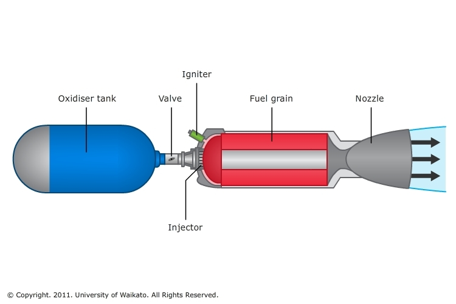

#+LATEX_CLASS: article
#+LATEX_CLASS_OPTIONS: [fleqn]
#+LATEX_HEADER: \usepackage{parskip}
#+LATEX_HEADER: \usepackage{enumitem}
#+LATEX_HEADER: \usepackage[
#+LATEX_HEADER:   letterpaper,
#+LATEX_HEADER:   top=2cm,
#+LATEX_HEADER:   bottom=2cm,
#+LATEX_HEADER:   left=3cm,
#+LATEX_HEADER:   right=3cm,
#+LATEX_HEADER:   marginparwidth=1.75cm
#+LATEX_HEADER: ]{geometry}
#+LATEX_HEADER: \setlist[itemize]{label=--}

* People

Avionics:
- Nick (also propulsion)

Payload:
- Mica (contact about Pilotix)

Propulsion:
- Francesco (adapters)
- Robert (parametric)
- Nils (WhatsApp guy, propulsion not-lead)
- David (not-fuel grain guy)

Airbreak:
- Iheb Bouakira (CFD)

Python RocketCEA

* Code

Input variables:

- Tank
  + Injector hole count
  + Injector total hole area

- Fuel grain:
  + Fuel inner radius
  + Fuel outer radius

- Combustion chamber and nozzle:
  + Throat length
  + Throat radius
  + Converging throat section angle
  + Nozzle length
  + Inner liner thickness
  + Pre-combustion chamber length
  + Post-combustion chamber length
  + Chamber inner radius
  + Chamber outer radius
  (I want to specify all of these in a generic manner as $f(z)$)

- Thrust
- Burn time

Output variables:
- Specific impulse

#+CAPTION: Design of a hybrid rocket engine
#+NAME:    fig:hybrid-schematic

#+CAPTION: Design of a convergent-divergent nozzle
#+NAME:    fig:nozzle-schematic

** Theory

*** Notation

- $h$ :: altitude above sea level

- $\mathcal A$ :: attitude, represented by either a 3-vector of Eulerian angles
  or a quaternion

- $(\cdot)^*, (\cdot)_\text{t}$ :: value of a variable at the throat of the
  convergent-divergent nozzle

- $(\cdot)_\text{c}$ :: value of a variable inside the combustion chamber at the
  entrance of the nozzle

- $(\cdot)_\text{e}$ :: value of a variable at the exit of the nozzle

- $(\cdot)_\text{amb}$ :: "ambient" value of a variable in the environment
  outside the rocket, for example $P_\text{amb}$

*** General

2D attitude lookup table:
$\mathcal A : \mathbb R^3, \mathbb R^3 \to \mathbb R^3 | \mathbb H$,
$\mathcal A(\mathbf x, \mathbf v)$

Ideal rocket equation:

\begin{equation*}
\Delta v
= v_e \ln\frac{m_\text{i}}{m_\text{f}}
= I_\text{sp} g_0 \ln\frac{m_\text{i}}{m_\text{f}}
\end{equation*}

Thrust equations:

\begin{equation*}
\dot{m} = \rho_\text{e} u_\text{e} A_\text{e}
\end{equation*}

\begin{equation*}
T
= \dot{m} u_\text{e} + (P_\text{e} - P_\text{a}) A_\text{e}
= \dot{m} u_\text{e} + P_\text{e} A_\text{e} - P_\text{a} A_\text{e}
= T_\text{vac} - (P_\text{a} \cdot A_\text{e})
\end{equation*}

Total force acting on the rocket:

\begin{equation*}
F = T - D
\end{equation*}

(thrust - drag)

References:

[[https://www.grc.nasa.gov/WWW/k-12/airplane/rktthsum.html]]

[[https://rrs.org/2023/01/28/making-correct-parabolic-nozzles/]]

*** Plumbing/injector

~30 bar pressure loss between tank and fuel grain

Either pressure drop or mass flow rate across the injector

*** Chamber/nozzle

In the following, let the asterisk superscript denote the value of a function of
the vertical position $z$ at the throat.

Area-mach relation:

\begin{equation*}
\frac{A(z)}{A^*}
= \frac{1}{M(z)} \left[
  \frac{2}{\gamma+1} \left(1 + \frac{\gamma-1}{2} M^2(z)\right)
\right]^{\frac12\frac{\gamma+1}{\gamma-1}}
\end{equation*}

where $A^*$ is the throat area, $M(z)$ is the Mach number at coordinate $z$.

Mass flow rate:

\begin{equation*}
\dot{m}
= A(z) P(z) \sqrt{\frac{\gamma}{T R}} M(z) \left[
  1 + \frac{\gamma-1}{2}M^2(z)
\right]^{-\frac12 \frac{\gamma+1}{\gamma-1}}
\end{equation*}

where $T$ is the chamber temperature, $R$ is the ideal gas constant, $\gamma$
the specific heat ratio. For maximum flow rate, set $M(z^*)=1$:

\begin{equation*}
\dot{m}
= A^* P^* \sqrt{\frac{\gamma}{TR}}
  \left[ \frac{\gamma+1}{2} \right]^{-\frac12 \frac{\gamma+1}{\gamma-1}}
\end{equation*}

This is then used to calculate thrust according to the previous formula

References:

[[https://web.stanford.edu/~cantwell/AA284A_Course_Material/Karabeyoglu%20AA%20284A%20Lectures/AA284a_Lecture2.pdf]]

[[https://www.grc.nasa.gov/WWW/K-12/airplane/astar.html]]

[[https://www.grc.nasa.gov/WWW/K-12/airplane/isentrop.html]]

[[https://rrs.org/2023/01/28/making-correct-parabolic-nozzles/]]

** The CEA rocket solver

The CEA rocket solver is a thermodynamic state-finder that follows a parcel of
gas as it moves from the chamber to the exit assuming an isentropic path (line
of constant entropy). The solver always calculates at least two points: the
chamber and the throat. All points specified in the parameters by the user will
then be appended to the list of snapshot points.

Consider packaging the incoming reactant mixture as follows:

#+begin_src python
  mixture = [
      { name: "H2(L)", temp: 20.27, fraction: 1.0, fuel_weight: 1.0, oxidant_weight: 0.0 },
      { name: "O2(L)", temp: 90.17, fraction: 1.0, fuel_weight: 0.0, oxidant_weight: 0.1 },
  ]
#+end_src

Isolating the essential arguments of the CEA rocket solver, one can define a
function of the following form:

#+begin_src python
  def solve(
      mixture : dict,        # mixture component dictionary
      pc      : float,       # chamber pressure
      subar   : list[float], # subsonic area ratio
      supar   : list[float]  # supersonic area ratio
  ) -> cea.RocketSolution:

      ... # implementation details

      solver.solve(solution, weights, pc, pi_p, subar=subar, supar=supar, hc)

      return solution
#+end_src

- ~mixture~ :: is some kind of table packaging together the chemical components
  of the fuel and oxidizer, their temperatures

- ~pc~ :: being the chamber pressure, a design variable

- ~subar~ :: being the subsonic area ratio, $A_\text{c}/A^*$

- ~supar~ :: being the supersonic area ratio, $A_\text{e}/A^*$

- ~pi_p~ :: being the pressure ratio $P_\text{c}/P_\text{e}$ of chamber pressure
  to exit pressure. The reactants are ideally expanded at $P_\text{e} =
  P_\text{amb}$, however since the atmospheric conditions change during the
  flight, the ideal expansion condition

CEA computes /intensive/ properties (values per unit mass), to get /extensive/
properties (N and kg/s), we provide the scale in terms of the throat area $A^*$.

Mass flow:

\begin{equation*}
\dot{m} = \frac{P A^*}{c^*}
\end{equation*}

where $P$ is the chamber pressure and $c^*$ is the /characteristic velocity/
computed with CEA.

Thrust:

\begin{equation*}
T
= \dot{m} I_\text{sp} g_0
= C_f A^* P
\end{equation*}

compute with $I_\text{sp}$ or $C_f$ (thrust coefficient) provided by CEA.

References:

[[https://nasa.github.io/cea/examples/rocket/example8.html]]

** My own set of inputs

Flight plan: attitude as a function of altitude and velocity, or pitch as a
function of velocity

Aerodynamic

Mass and CoG time-series (CoG from mass flow?)

Chemical composition time-series -> (gamma, M_w, T) change

Nozzle erosion?

---

A(x,v)

C_D(v, atm)

M_0 (~25.0 kg total) M_f M_O

---

P_T = 60 bar

P_c = 30 bar

P_inj > 30 bar

NOTE: optimizing for sea-level thrust

Regression rate
